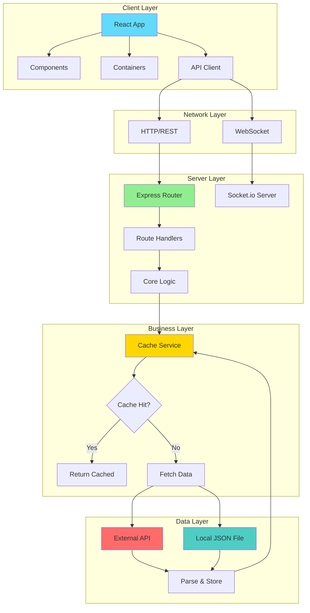

# Solutions V2

A full-stack template project demonstrating both standard REST API and WebSocket implementations using React.js and Node.js/Express.

Built in November 2018. This project provides two complete implementations of a photo gallery application: a traditional REST API version and an enhanced WebSocket-enabled version for real-time communication.

## Features

- 🎨 React.js frontend with modern component architecture
- ⚡ Express.js backend with RESTful API
- 🔄 Two implementations: Standard REST and WebSocket
- 💾 Caching layer with configurable TTL
- 🌐 CORS support for cross-origin requests
- 📝 Winston logging for server monitoring
- 🔌 Socket.io integration for real-time features
- 📦 Multiple data sources (external API or local JSON)
- 🏗️ Clean architecture with separation of concerns

## Architecture



## Project Structure

```
solutions-v2/
├── normal-state/              # Standard REST API implementation
│   ├── client/                # React frontend
│   │   ├── src/
│   │   │   ├── api/           # API client layer
│   │   │   ├── components/    # Reusable UI components
│   │   │   ├── containers/    # Page-level containers
│   │   │   ├── hoc/           # Higher-order components
│   │   │   ├── settings/      # Client configuration
│   │   │   └── utils/         # Utility functions
│   │   └── package.json
│   └── server/                # Express backend
│       ├── api/               # External API calls
│       ├── config/            # Environment configs
│       ├── core/              # Business logic & caching
│       ├── datafile/          # Local data storage
│       ├── middleware/        # CORS, error handling
│       ├── models/            # Data models & parsers
│       ├── routes/            # API route definitions
│       ├── startup/           # App initialization
│       ├── utils/             # Cache service & utilities
│       └── package.json
├── normal-state-websocket/    # WebSocket-enabled implementation
│   ├── client/                # React with Socket.io client
│   └── server/                # Express with Socket.io server
│       └── startup/
│           └── websocket.js   # WebSocket configuration
├── CONTRIBUTING.md
├── INSTRUCTIONS.md
├── LICENSE
└── README.md
```

## Getting Started

### Prerequisites

- Node.js (v10 or higher)
- npm or yarn
- Git

### Installation

1. Clone the repository:
```bash
git clone https://github.com/orassayag/solutions-v2.git
cd solutions-v2
```

2. Choose your implementation:
   - `normal-state/` - Standard REST API
   - `normal-state-websocket/` - WebSocket-enabled

3. Install and run the server:
```bash
cd normal-state/server  # or normal-state-websocket/server
npm install
npm start
```

4. In a new terminal, install and run the client:
```bash
cd normal-state/client  # or normal-state-websocket/client
npm install
npm start
```

5. Open your browser to `http://localhost:3001`

## API Endpoints

### Get All Photos
```http
GET /api/photos
GET /api/photos?count=10
```

Returns a list of photos. Optional `count` parameter limits results.

### Get Photo by ID
```http
GET /api/photos/:id
```

Returns a specific photo by its ID.

## Configuration

### Server Configuration

Edit files in `server/config/`:
- `config.development.json` - Development settings
- `config.production.json` - Production settings
- `config.test.json` - Test settings

```json
{
  "PORT": 3000,
  "PHOTOS_API_URL": "https://jsonplaceholder.typicode.com/photos",
  "PHOTOS_JSON_PATH": "./datafile/photos.json",
  "CACHE_TTL": 3600
}
```

### Client Configuration

Edit files in `client/src/settings/`:
```json
{
  "API_URL": "http://localhost:3000"
}
```

## Key Features

### Caching System
Implements an in-memory cache with configurable TTL:
- Default: 1 hour (3600 seconds)
- Reduces external API calls
- Improves response times
- Implementation: `utils/CacheService.js`

### Data Sources
Supports two data sources:
1. **External API**: JSONPlaceholder (default)
2. **Local File**: JSON file storage

Switch between sources in `routes/photos.js`:
```javascript
response = await coreGetPhotosAPI(count);   // External API
response = await coreGetPhotosFile(count);  // Local file
```

### WebSocket Support (websocket version)
Real-time bidirectional communication using Socket.io:
- Client-server event system
- Connection management
- Disconnect handling
- Foundation for real-time features

## Built With

* [React.js](https://reactjs.org) - Frontend framework
* [Node.js](https://nodejs.org) - Runtime environment
* [Express](https://expressjs.com) - Web framework
* [Socket.io](https://socket.io) - WebSocket library (websocket version)
* [Winston](https://github.com/winstonjs/winston) - Logging library
* [Axios](https://axios-http.com) - HTTP client
* [node-cache](https://github.com/node-cache/node-cache) - Caching solution

## Contributing

Contributions are welcome! Please read [CONTRIBUTING.md](CONTRIBUTING.md) for details on the process for submitting pull requests.

## Documentation

- [INSTRUCTIONS.md](INSTRUCTIONS.md) - Detailed setup and usage instructions
- [CONTRIBUTING.md](CONTRIBUTING.md) - Guidelines for contributing

## Versioning

We use [SemVer](http://semver.org) for versioning.

## Author

* **Or Assayag** - *Initial work* - [orassayag](https://github.com/orassayag)
* Or Assayag <orassayag@gmail.com>
* GitHub: https://github.com/orassayag
* StackOverflow: https://stackoverflow.com/users/4442606/or-assayag?tab=profile
* LinkedIn: https://linkedin.com/in/orassayag

## License

This project is licensed under the MIT License - see the [LICENSE](LICENSE) file for details.